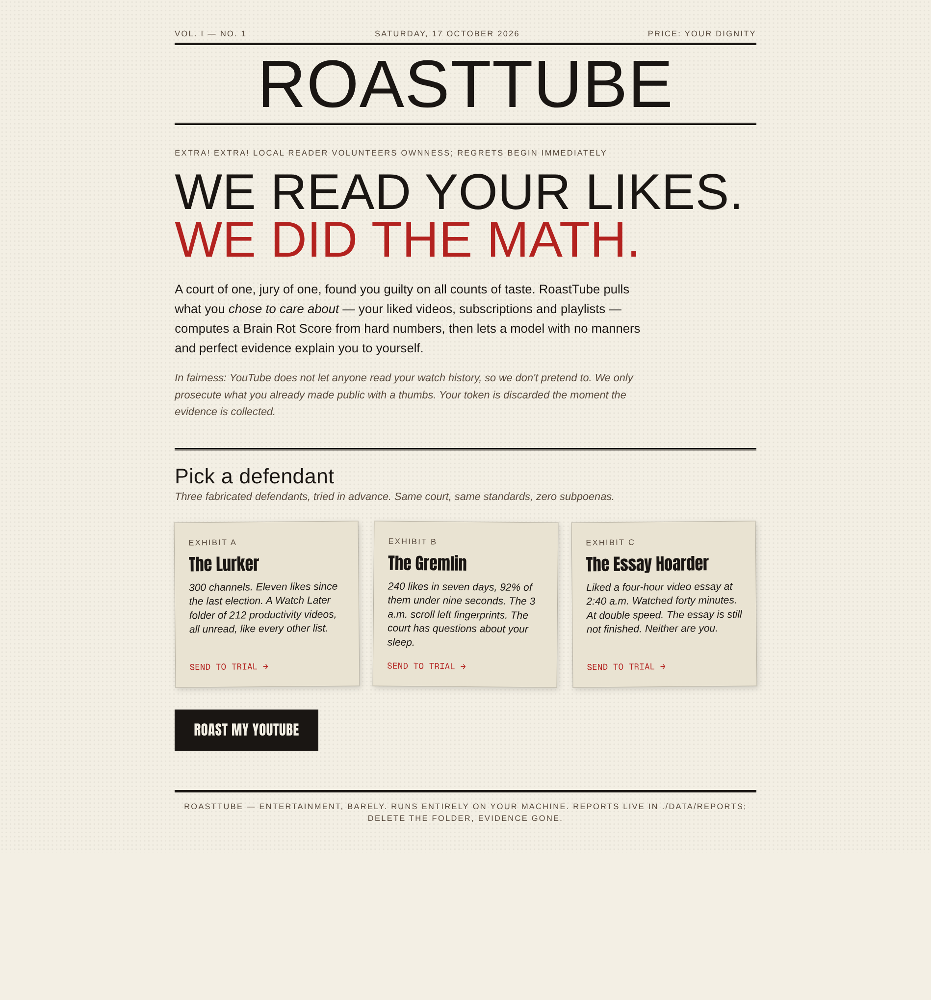
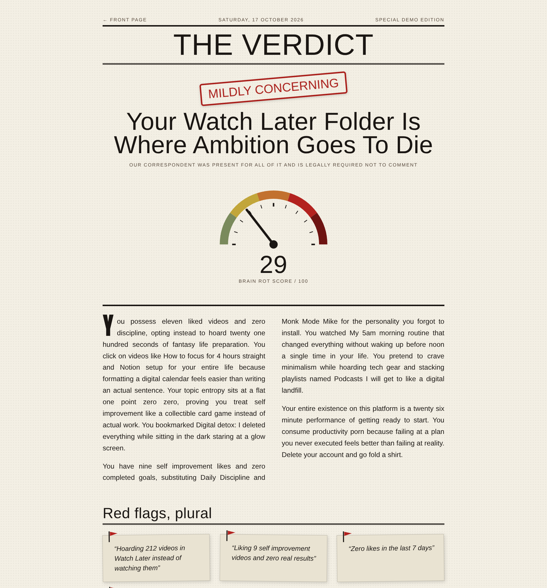
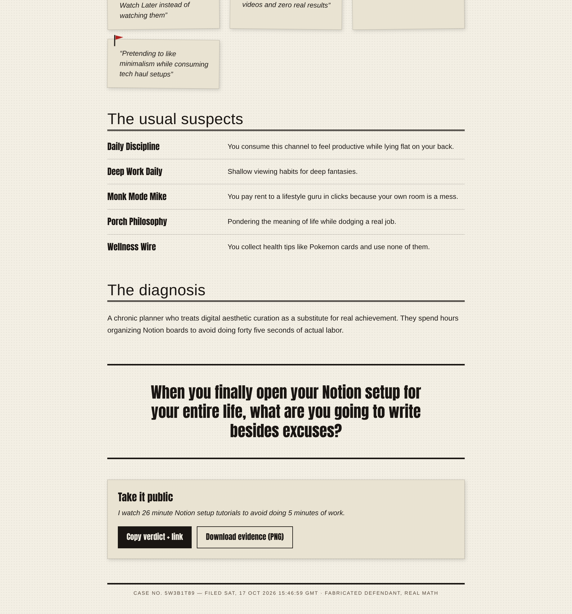

<p align="center"></p>

# RoastTube

**Live at [roasttube.piyushmehta.com](https://roasttube.piyushmehta.com).** Vol. I, No. 1, October 2026.

Sign in with Google. RoastTube reads your YouTube likes, subscriptions, playlists and Watch Later, computes hard statistics in TypeScript, and lets Gemini write a tabloid roast: a **Brain Rot Score**, red flags, channel-by-channel takedowns, a personality diagnosis, and one closing question you will think about in the shower.

YouTube does not expose watch history to any API, and RoastTube never pretends otherwise. It roasts what you *chose to care about*: the videos you liked, the channels you follow, the playlists you hoard.

## The report

<p align="center"></p>

A demo persona (The Lurker) after trial. Every number in a roast traces back to the victim's own data, and the score is computed in code, so the model cannot flatter you.

<p align="center"></p>

Red flags, the usual suspects, the diagnosis, and a share card you can screenshot or download as PNG.

## What it does

- **Collects** your liked videos (up to 200), subscriptions, named playlists, and Watch Later count through the YouTube Data API v3, inside a 20-unit quota budget. A full run spends about 9.
- **Computes** the signals: Shorts ratio, average and longest liked-video length, topic entropy, category mix, late-night likes, binge days, self-improvement videos liked (vs. completed: zero), ragebait, procrastination bait, Watch Later hoard, lurker index, and contradictions between playlist names and actual behavior.
- **Scores** with fixed weights, and the hard-computed score always overrides whatever the model self-reports.
- **Writes** a 3 to 5 paragraph roast, red flags, one line per top channel, a diagnosis, a closing question, and a shareable one-liner. Gemini receives only the computed stats, never your raw account.
- **Humanizes** the text before it ships: a normalizer strips the tells of AI writing (em dashes, literal "Paragraph 2:" labels) and the system prompt bans the stock phrases and sentence shapes models fall back on.
- **Stores** each report so links keep working: a JSON file under `data/reports/` in local dev, a Cloudflare Workers KV entry in the hosted copy. Reports render at `/report/<id>` with a PNG share card.
- **Protects** the hosted demo with a Turnstile check, a rate limit of 3 roasts per hour per IP, and a daily budget of 15 roasts.

## The Brain Rot Score

| Weight | Signal |
| --- | --- |
| 25 | Shorts ratio |
| 20 | Likes per day (velocity) |
| 15 | Average video length (shorter is worse) |
| 15 | Ragebait liked |
| 10 | Self-improvement videos liked and never acted on |
| 10 | Watch Later hoard size |
| 5 | Topic entropy |

| Score | Tier |
| --- | --- |
| 20 and under | Well Adjusted |
| 21 to 40 | Mildly Concerning |
| 41 to 60 | Unhinged |
| 61 to 80 | Terminal |
| 81 and up | Please Go Outside |

Weights live in `src/lib/score.ts` and are easy to argue with. Bring data.

## Demo mode

Three fabricated defendants ship in the repo (The Lurker, The Gremlin, The Essay Hoarder). No Google account and no OAuth client are needed. You do need a free Gemini API key.

```bash
npm install
cp .env.example .env.local   # paste your GEMINI_API_KEY
npm run dev
```

Open http://localhost:3000 and send a persona to trial.

## Real Google login

For local development the app works fine in Google OAuth **Testing** mode: add yourself as a test user, no review needed, and click past the warning (Advanced, then Continue). The hosted copy is going through Google's verification review; until it clears, new users see the unverified-app warning, and while the app sits in Testing mode only added test users can get in at all. The wizard handles the Google Cloud side and writes the credentials for you:

```bash
./scripts/setup-google-oauth.sh
```

It walks through creating a project, enabling the YouTube Data API v3, configuring the consent screen, creating a Web application OAuth client with a redirect URI (`http://localhost:3000/api/auth/callback/google`, plus your deployed domain's callback for the hosted copy), and writing `GOOGLE_CLIENT_ID` and `GOOGLE_CLIENT_SECRET` into `.env.local`. The only scope requested is `youtube.readonly`.

## Deploy your own

The hosted copy runs on Cloudflare's free plan: Workers for the app, KV for reports, Turnstile for the demo button.

1. Log in: `cf auth login` (or `npx @vinext/cloudflare auth login`).
2. Get a free Gemini key from [Google AI Studio](https://aistudio.google.com/apikey) and create a Google OAuth client (Web application) whose redirect URIs include `https://your-domain/api/auth/callback/google`.
3. Run:

```bash
./scripts/setup-cloudflare.sh
```

It walks through the login, writes `.dev.vars`, offers to register a Turnstile widget, deploys once to create the Worker and its KV namespace, uploads the secrets, and deploys again. Point a custom domain at the Worker, or use the `workers.dev` address.

Free-tier caveats: Workers allows 100k requests a day on the free plan; the demo cache holds each persona's roast for an hour so repeat visits cost nothing; the daily budget (`DAILY_ROAST_BUDGET`, 15) exists because the Gemini free tier caps requests per day.

## Environment variables

| Variable | Required | Purpose |
| --- | --- | --- |
| `GEMINI_API_KEY` | yes | Roast generation. Free key from Google AI Studio. |
| `GEMINI_MODEL` | no | Overrides the default `gemini-3.5-flash`. Falls back to `gemini-flash-lite-latest` on 429 or 503 automatically. |
| `GOOGLE_CLIENT_ID`, `GOOGLE_CLIENT_SECRET` | for real login | Without them the app runs demo mode only. |
| `NEXT_PUBLIC_APP_URL` | no | Base URL, defaults to `http://localhost:3000`. |
| `RT_COOKIES` | no | `true` forces Secure cookies on localhost to exercise the production cookie path. |
| `SESSION_SECRET` | hosted | Seals the session cookie. The Cloudflare wizard generates one. |
| `TURNSTILE_SITE_KEY`, `TURNSTILE_SECRET_KEY` | hosted | Cloudflare Turnstile keys for the demo button. Localhost uses the always-pass test pair. |
| `DAILY_ROAST_BUDGET` | no | Roasts per day cap in production, 15 by default. |

## How it works

1. **OAuth.** Hand-rolled authorization code flow with PKCE (S256), about 60 lines in `src/lib/oauth.ts`. The access token lives in a sealed, HttpOnly session cookie and is never written to server storage; no refresh token is requested.
2. **Collection.** `src/lib/youtube.ts` walks likes, subscriptions, playlists and Watch Later with a hard quota budget and clear errors for locked playlists.
3. **Signals and score.** Pure functions in `src/lib/signals.ts` and `src/lib/score.ts` turn the collected data into numbers and the Brain Rot Score. Both are unit-tested against fixtures.
4. **Roast.** `src/lib/prompt.ts` builds a stats-only prompt with a strict JSON response schema. `src/lib/gemini.ts` calls the Gemini REST API, retries on quota pressure, and falls back to a lighter model.
5. **Humanizer pass.** The generated text is normalized: em dashes become commas or sentence breaks, stray "Paragraph N:" labels become real paragraph breaks. The writing rules in the system prompt follow [Wikipedia's Signs of AI writing](https://en.wikipedia.org/wiki/Wikipedia:Signs_of_AI_writing).
6. **Report.** Stored as JSON, under `data/reports/` in dev and Workers KV when hosted, and rendered as a newspaper page with a typewriter effect, a share card, and a copyable link.

## Tests

```bash
npm test          # node --test, 90 tests
npx tsc --noEmit  # types
npm run lint      # eslint
npm run build     # production build
```

The suite covers scoring math, signal extraction, category classification, prompt shape, report storage, demo personas, and the text normalizers. No test framework is installed; Node runs TypeScript directly.

## Development notes

- **No new runtime dependencies**, please. YouTube and Gemini are called with native `fetch`; reports are small JSON documents, never a database; tests use `node --test`. This keeps the install under a minute and the supply chain small.
- Reports live as JSON files in dev. Delete one with `rm data/reports/<id>.json`, or wipe all evidence with `rm -rf data/reports`. The hosted copy keeps them in Workers KV instead.
- Rate limit: 3 roasts per hour per IP, plus a Turnstile check and a daily roast budget on the hosted demo. The YouTube collector refuses to spend more than 20 quota units in a run.
- Sessions are sealed cookies, not a server-side store. The secret comes from `SESSION_SECRET`; without it dev falls back to a per-process key, so a restart signs you out, by design.
- Node 24 or newer is required (the tests rely on native TypeScript stripping).

## Project layout

```
src/app          pages and API routes (auth, roast, report)
src/components   tabloid UI pieces (score gauge, roast stream, share card)
src/lib          oauth, youtube collector, signals, score, prompt, gemini, store
scripts          setup wizards for Google OAuth and Cloudflare
tests            node --test suite
```

## Contributing

Issues and pull requests are welcome. See [CONTRIBUTING.md](CONTRIBUTING.md) for setup, the bar for new dependencies, and what makes a good roast improvement. If this made you laugh, a star helps other people find it.

## Limitations

- Watch history is unavailable through any YouTube API. The app roasts likes, subscriptions and playlists instead.
- The hosted copy is in Google's verification pipeline, so new users still see the unverified-app warning until it clears.
- The Gemini free tier allows roughly 20 flash requests per day; the hosted copy budgets 15 roasts a day, and the model fallback exists for that reason.
- The hosted copy runs on Cloudflare's free plan (Workers, KV, Turnstile). It is sized for a demo, not for load.

## License

MIT. See [LICENSE](LICENSE).

RoastTube is not affiliated with YouTube or Google. It uses the YouTube Data API v3 and the Gemini API under Google's terms. Reports are satire, generated by a language model from your own activity. The roast is the product.
